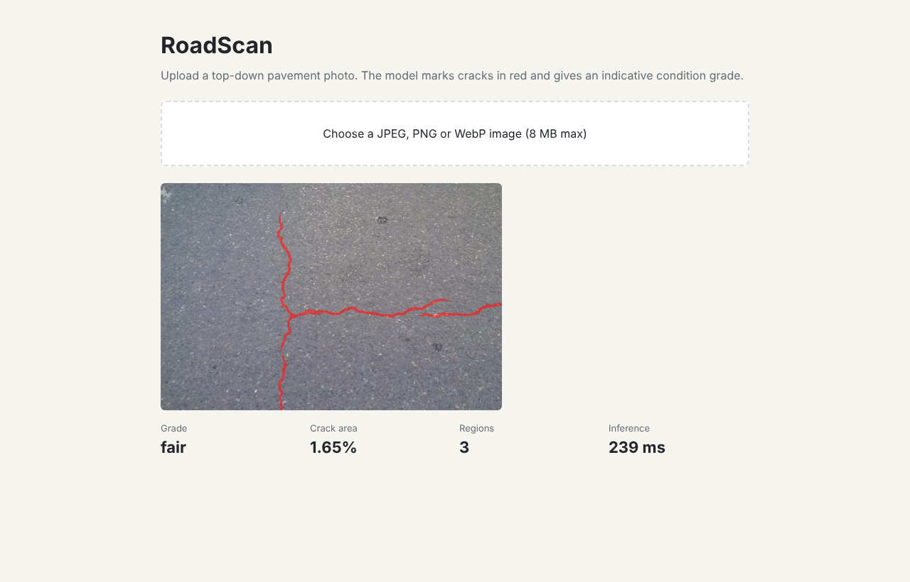

# RoadScan: road crack detection API


Upload a pavement photo and get back a crack overlay, crack area, region count and an indicative condition grade. A compact U-Net runs on CPU behind a FastAPI service.



*Demo image from the CrackForest dataset.*

## Results
Held-out CrackForest test set of 18 images at 480x320. Full numbers are in [`reports/evaluation.json`](reports/evaluation.json).

| Metric | U-Net | Classical baseline |
|---|---:|---:|
| F1, 2 px tolerance | 0.913 | 0.457 |
| F1, exact pixels | 0.671 | 0.271 |
| IoU, 2 px tolerance | 0.855 | 0.313 |

Median CPU inference time was 157 ms per image on a 2-core machine. The 2 px tolerance is common in crack detection because hand-drawn labels are not pixel-perfect. With 18 test images, treat these as estimates.

## Run it
```bash
pip install -r requirements-dev.txt
make check   # lint and tests
make serve   # http://localhost:8000
```
Or with Docker:
```bash
docker build -t roadscan . && docker run -p 8000:8000 roadscan
```
To retrain, run `make train && make evaluate`.

## API
```bash
curl -F file=@road.jpg http://localhost:8000/v1/inspect
```
Interactive docs are at `/docs`. `/healthz`, `/readyz` and `/metrics` support operations.

## Development lifecycle
| Stage | Where |
|---|---|
| Requirements | [docs/requirements.md](docs/requirements.md) |
| Design and decisions | [docs/design.md](docs/design.md), [docs/adr](docs/adr) |
| Testing | [docs/test-plan.md](docs/test-plan.md), [tests](tests) |
| CI/CD | [.github/workflows/ci.yml](.github/workflows/ci.yml), [Dockerfile](Dockerfile) |
| Operations | [docs/runbook.md](docs/runbook.md) |

## Limits
Grades are illustrative and are not a Pavement Condition Index. The demo has no authentication or rate limiting. Performance on other cameras or angles has not been measured.

## Data and license
Code is MIT. [CrackForest](https://github.com/cuilimeng/CrackForest-dataset) is for non-commercial research, so it is not stored here, and the included model weights should be treated the same way. Please cite Shi et al. (2016) if you use the dataset.

## How this was built

Built with AI assistance (Claude). Commit messages credit it as co-author. I reviewed the design and can explain the tradeoffs.
