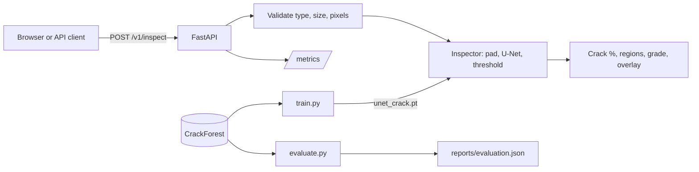

# Design

## Training
- Fixed 70/15/15 split by image, seeded so every run scores the same test set.
- Random 192 px crops with flips, rotations and brightness changes. CrackForest has only 118 labelled images, so augmentation matters most here.
- Crops favour regions containing cracks because crack pixels are rare.
- Loss is weighted BCE plus Dice, for the same reason.
- The best checkpoint is chosen on validation F1. The test set is used once, in `evaluate.py`.

## Serving
- One model instance loaded at start-up. Inference runs in a FastAPI async handler, so requests are handled one at a time per process. That is acceptable for a demo; see ADR 0002.
- Images are downscaled to 1024 px on the long side to bound latency and memory.
- Width and height are edge-padded to a multiple of 8, as required by three pooling layers, then the output is cropped back.

## Security
Uploads are checked for byte size, real format (from content, not filename) and decoded pixel count, which protects against decompression bombs.
